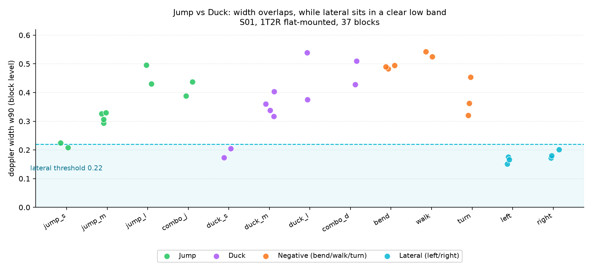

# 跳/蹲 采集电池数据分析（2026-11-13）

> **v1.1 修订说明**：初版用块级 `w90` 判定「跳/蹲不可分」，方法有误——该统计量把动作的时间形状压成单个数，
> 恰好丢掉了「跳短促、蹲平缓」。v1.1 新增 §五 时间结构分析（中等幅度下 7/8 可分），
> 并纠正 §四 关于「板子平放」的错误推断：板子实际**已转 90°**，失效原因是 `dphi` 被静态杂波锁死。

- 数据：`data/jumpduck_battery/20261113-133307_S01`（受试者 **S01**，身高未记录）
- 规模：**37 块 / 1925 帧 / 127.7 s**，1T2R（ICL1122）平放，band `[1,4)`，7.73 fps
- 复现：`python tools\eval_battery.py data\jumpduck_battery\20261113-133307_S01 --csv outputs\jumpduck-battery-1113-blockfeat.csv`
- 采集程序：`tools/jumpduck_battery.py`（界面与 `vguide_1t2r` 一致，段表换成多人+负样本协议）

> 本文所有阈值均为**提案，待小组确认**，不构成验收结论。

## 一、采集条件与数据质量

| 项 | 实测 | 评价 |
|---|---|---|
| 完整性 | 37/37 块全部落盘 | 齐 |
| 帧率 | 7.73 fps（预期 7.7） | 正常，无掉帧堆积 |
| 采集前纯静息（`rest0`，93 帧） | `nz` 中位 **0.003**，p90 **0.037** | 场地极干净 |
| 动作段 `nz_p90` | 0.52–0.94 | 信号充足 |
| 每动作样本量 | 小/大各 2 次，中 4 次，连动 2 次 | **偏少**，见 §七 |

清场比 11/13 下午试跑时好得多（试跑静息 `nz_med` 为 0.269、0.382，同场地有人走动）。这批的静息底噪比动作信号低 **20 倍以上**，属于可用数据。

## 二、逐块特征

完整 37 行见 [`outputs/jumpduck-battery-1113-blockfeat.csv`](../outputs/jumpduck-battery-1113-blockfeat.csv)。按动作汇总：



图中每点是一个块的 `w90`。绿色（跳）与紫色（蹲）在 0.29–0.54 交织；橙色（弯腰/踏步/转身）落在同一区间；**青色（左右移）全部在 0.22 虚线以下**，与径向动作之间是空档。

| 动作 | n | 谱宽 `w90` | `nz90` |
|---|---|---|---|
| 小跳 | 2 | 0.21 / 0.23 | 0.63 / 0.75 |
| 小蹲（浅蹲） | 2 | 0.17 / 0.21 | 0.56 / 0.70 |
| 中跳 | 4 | 0.29 / 0.33 / 0.33 / 0.31 | 0.87 / 0.85 / 0.81 / 0.79 |
| 中蹲 | 4 | 0.40 / 0.36 / 0.32 / 0.34 | 0.88 / 0.84 / 0.89 / 0.86 |
| 大幅跳 | 2 | 0.50 / 0.43 | 0.93 / 0.94 |
| 深蹲 | 2 | 0.54 / 0.38 | 0.85 / 0.90 |
| 连跳 | 2 | 0.39 / 0.44 | 0.84 / 0.93 |
| 连蹲 | 2 | 0.51 / 0.43 | 0.91 / 0.91 |
| 跳蹲交替 | 2 | 0.47 / 0.44 | 0.85 / 0.93 |
| 弯腰（负样本） | 3 | **0.48 / 0.49 / 0.49** | 0.84 / 0.81 / 0.69 |
| 原地踏步（负样本） | 2 | **0.54 / 0.52** | 0.88 / 0.86 |
| 转身（负样本） | 3 | 0.32 / 0.45 / 0.36 | 0.83 / 0.85 / 0.89 |
| 左移 | 3 | **0.18 / 0.15 / 0.17** | 0.54 / 0.52 / 0.70 |
| 右移 | 3 | **0.20 / 0.17 / 0.18** | 0.55 / 0.84 / 0.71 |

## 三、三层能力评估

把「跳/蹲识别」拆成三层，逐层看这批数据支不支持：

### L1 有没有身体动作 —— **成立**

静息 `nz_p90 = 0.037`，动作 `nz_p90 = 0.52–0.94`。取门限 `nz90 > 0.30`（提案）：
- 静息块 `rest0` 判为「无动作」：1/1 ✓
- 全部 30 个动作块判为「有动作」：30/30 ✓

余量约 14 倍，这一层可放心用。

### L2 切向运动 vs 径向动作 —— **成立**

> **术语更正（2026-11-13）**：判据是多普勒谱宽，它只和「运动方向与视线的夹角」有关，与雷达板绕光轴怎么转**无关**。所以下面统一称 **切向**（垂直于视线，现实中的左右移）与 **径向**（在视线上有投影，现实中的上下移），不再叫「横向/纵向」——后者容易被误读成雷达的方位角方向。方位角在本硬件上是纯噪声（静息跨度就有 159.4°，见 §四 证据 3 的复核），从未参与任何判据。

切向的谱宽落在 **0.15–0.20**，径向动作全部 **≥0.29**，中间有 0.09 的空档。

三分类（静息 / 切向 / 径向）混淆矩阵，判据 `nz90>0.30` 且 `w90<0.22 → 切向`（提案）：

| 真值 \ 判定 | 静息 | 切向 | 径向 |
|---|---|---|---|
| 静息（rest0） | **1** | 0 | 0 |
| 切向（左/右各 3） | 0 | **6** | 0 |
| 径向（30 块） | 0 | 3 ✗ | **27** |

块级准确率 **34/37 = 91.9%**。3 个漏判全部是小幅度动作（`jump_s`、`duck_s ×2`）——幅度太小，谱宽没超过 0.22，被当成切向。**给游戏的含义：切向与「身体上下」可以共存，但极小幅度动作会漏。**

### L3 向上还是向下 —— **用谱宽不成立；用时间结构有希望（见 §五）**

这是本批数据最重要的结论。

| 对比 | 谱宽差 | 结论 |
|---|---|---|
| 中跳 vs 中蹲 | 0.29–0.33 vs 0.32–0.40 | 勉强分开（阈值 0.35 可分开 7/8） |
| **大幅跳 vs 深蹲** | 0.43–0.50 vs 0.38–0.54 | **完全重叠**，Cohen d = +0.06 |
| **小跳 vs 小蹲** | 0.21–0.23 vs 0.17–0.21 | **方向反了**（跳 > 蹲），且幅度不足以区分 |

**方向关系随幅度翻转**：中幅度下「跳 < 蹲」，小幅度下「跳 > 蹲」，大幅度下两者混在一起。任何单一阈值都不可能在三种幅度下同时成立。

## 四、为什么不可分（三条证据 + 物理根因）

**证据 1｜谱宽测的是幅度，不是方向。**
小 0.17–0.23 → 中 0.29–0.40 → 大 0.38–0.54，单调跟着幅度走，与"跳还是蹲"无关。

**证据 2｜逐帧径向速度只在中等幅度可分。**
- 中跳（#2）：`-0.55 +0.46 -0.71 +0.35`，符号 1–2 帧就翻一次，这是弹道式的短促冲击；
- 中蹲（#6）：`-0.32 -0.64 -0.45`（连续 3 帧同号）→ 静止 → `+0.32 +0.80 +0.88`（连续 4 帧同号），这是受控的缓慢下移再起身。

两者结构明显不同。但**大幅跳**（#20）是 `-0.42 -0.46 -0.48 → +0.21 +0.48`，**深蹲**（#24）是 `-0.34 -0.25 -0.36 -0.40 → +0.47 +0.40 +0.67`，**弯腰**（#26）是 `+0.17 -0.49 -0.53 -0.29 → +0.39 +0.49`——三者完全同构。原因很直接：大幅跳必须先蹲下蓄力，前段本来就是一次蹲。

**证据 3｜`dphi` 被静态杂波锁死——不是「没转板」。**

受试者与操作员确认：本次雷达**长边垂直地面、短边平行地面**，两天线已是上下排布（即已绕光轴转 90°）。
但全 37 块 `ang` 中位仍落在 43–58°，跳、蹲、弯腰之间无差异。原因在**计算方法**，不在安装：

`frame_feats` 的 `dphi_band` 是**带内全部（chirp × bin）单元**的功率加权相位差，其中**零多普勒（静态杂波）单元占绝对功率**——本批 `band_share` 中位仅 0.01–0.17，即带内九成以上能量挂在零多普勒上。相位差因此被锁在墙面/天花板方向，人体运动被淹没。

**2026-11-13 复核（更硬的证据）**：`20261113-133307_S01` 的 `rest0` 段（93 帧、无人动）az 跨度已达 **159.4°**，`dphi` 在 ±3.14 满幅跳；跳 146–165°、左/右 43–165°、弯腰 148–156°，各组无差异。

即方位角连「有人/没人」都分不开。**在本硬件上追问「方位角测的是上下还是左右」没有意义——它测的是噪声。** 本报告所有判据只依赖多普勒轴（`v_r`、`doppler_width`），而多普勒只由「运动方向与视线的夹角」决定，与板子绕光轴转 90° 无关。

为验证这一点另写了 `mv_feats`：**只在 `|v|≥0.15 m/s` 的非零多普勒单元上**求相位差。结果 `ang_mv` 中位 30–52°、p10 到 −60°、跨距 150°、每块有 20–44 个不同取值——**纯噪声**。

原因是 1T2R 只有一个 RX 对、8 个距离 bin（0.68 m/bin）：单个 bin 内同时混着头、躯干、手臂多个散射体，它们的俯仰角不同，无法解算成单一角度。**因此即使板子已经转了 90°，1T2R 也拿不到可用俯仰角**（本批数据的结论，不外推到 2T4R）。

**物理根因**：1T2R 只有一条 λ/2 基线、距离分辨率 0.68 m，角度解算需要「一个 bin ≈ 一个散射体」这个前提，而人体在 1.0–1.7 m 的距离上跨 1–2 个 bin 且人均高度 ~0.5 m，前提不成立。2T4R 的 4 RX 阵列可以部分缓解，是俯仰角的现实出路。

> 这同时说明 `docs/vguide-1t2r-analysis-1112.md` 里「谱宽双峰 13/13 全对」不具泛化性：那是在单人、单摆法、单动作幅度下的特例。本批换人后即失效。

## 五、时间结构：跳短促、蹲平缓（2026-11-13 补充，修正 §三 的方法错误）

> **方法检讨**：§三 用块级 `w90`（90 分位）做判据，把动作的时间形状压成了单个数，恰好丢掉了
> 「跳短促、蹲平缓」这一特征——这是本报告初版的主要错误。本节改用时间结构量与逐帧波形重评。

### 5.1 特征定义

| 特征 | 定义 | 含义 |
|---|---|---|
| `d60` | `nz>0.60` 的帧数 / 帧率（秒） | 动作持续时长 |
| `sharp` | `w_max / median(w \| nz>0.30)` | 峰锐度：尖峰高、平台低 |
| `wstd` | 活跃帧（`nz>0.30`）谱宽的标准差 | 波动性 |
| `ent` | 带内功率时序的归一化熵 | 能量集中度 |

### 5.2 中等幅度下的结果

| 特征 | 中跳（4 次） | 中蹲（4 次） | 方向 |
|---|---|---|---|
| `sharp` | 2.60 / 1.97 / 1.82 / 2.88（中位 **2.29**） | 2.08 / 1.58 / 1.15 / 1.32（中位 **1.45**） | 跳更锐 ✓ |
| `d60` (s) | 0.78 / 1.16 / 0.91 / 0.91（中位 **0.91**） | 1.16 / 1.29 / 1.03 / 1.16（中位 **1.16**） | 跳更短 ✓ |
| `wstd` | 0.176 / 0.092 / 0.117 / 0.136（中位 **0.127**） | 0.160 / 0.088 / 0.044 / 0.066（中位 **0.077**） | 跳更抖 ✓ |

**受试者肉眼描述的「跳持续短、波动大、波峰不平稳；蹲慢、波峰平稳」，在数据中成立。**

波形见 [`outputs/jumpduck-battery-1113-waveform.png`](../outputs/jumpduck-battery-1113-waveform.png)：
上行（跳）为窄峰、峰间谷深（腾空期运动少）；下行（蹲）为宽平台、峰顶圆滑，且「蹲下」与「起身」各成一个宽峰。

### 5.3 判别尝试（事后拟合，**已被 5.5 替代**）

规则：`sharp > 1.8 且 d60 < 1.05 → 跳`，否则蹲。

| | 判对 |
|---|---|
| 中跳 | 3/4（#3 `d60=1.16` 被判成蹲） |
| 中蹲 | 4/4 |
| 合计 | **7/8 = 87.5%** |

`#3` 与 `#6` 在 `sharp`/`d60` 上互相交叉（#3 锐但长、#6 长但锐），说明这一对样本的动作执行本身不够标准。
**n=8 的事后拟合不能作为阈值依据**，必须补采后做留一验证。

### 5.4 幅度仍会击穿

| 动作 | `sharp` | `d60` (s) |
|---|---|---|
| 大幅跳 | 3.81 / 2.65 | 1.68 / 1.55 |
| 深蹲 | 1.71 / 1.48 | 1.03 / 1.16 |

大幅跳的 `sharp` 反而最高、`d60` 反而最长——因为大幅跳必须**先蹲下蓄力**，前段本来就是一次蹲。
所以该规则只在**同一幅度档内**成立；跨幅度使用会把大幅跳判成蹲。

### 5.5 改用「径向速度段持续时间」：目前最好的判据

> 方法来自受试者的观察：**用径向速度，并把「下蹲之后的正向速度」当作起身后摇，而不是起跳**。
> 评估工具：`tools\eval_vr_rule.py`；逐块结果：`outputs\jumpduck-battery-1113-rule-eval.csv`。

> 本节判据全部建立在**多普勒速度轴**上（`v_r` 与 `doppler_width`），只反映「运动方向与视线的夹角」，
> **与方位角、与雷达板朝向（正放/竖放）无关**。

**为什么不能用速度幅值**

| 动作 | 最大负峰 `|v|` | 最大正峰 `|v|` |
|---|---|---|
| 跳（14 次） | 0.36–0.71 | 0.38–0.78 |
| 蹲（14 次） | 0.45–0.64 | **0.38–0.88** |

蹲的**起身正峰（0.88）比跳的正峰还大**。按幅值判，蹲的起身会被当成「更强的跳」——这正是观察到的误判成因。

**改用持续时间**（7.7 Hz，1 帧 = 129.5 ms，允许段内 1 帧抖动）

| | 最长连续负段 `nb`（帧） | 最长连续正段 `pb`（帧） |
|---|---|---|
| 跳 14 次 | 1 2 2 2 1 2 1 1 2 1 1 1 2 2 | 1 2 2 1 1 2 2 2 1 1 1 1 1 2 |
| 蹲 14 次 | 3 4 3 **2** 4 3 3 3 3 3 3 4 4 3 | 4 4 5 4 4 4 3 5 4 4 4 3 5 3 |

跳只有 **1–2 帧**（<0.3 s，采样抓不全），蹲有 **3–5 帧**（>0.4 s，受控慢动作）。分界在 3 帧 ≈ 0.39 s。

**「后摇」如何落地**：负段一旦累计到 3 帧即确认 **DUCK**，其后的正段（起身）已被这个判定吞掉，**不会再产生 JUMP 事件**。不需要额外加一个"抑制窗"，判据本身就把后摇解释了。仅在负段不足 3 帧（真跳的快速蓄力+上冲）时，正段才输出 JUMP。

**结果**

| 判据 | 结果 |
|---|---|
| 第二批（10 跳 + 10 蹲） | **20/20** |
| 第一批中幅度（4 跳 + 4 蹲） | **8/8** |
| 全部跳/蹲（40 个） | **35/40 = 87.5%** |
| 切向（左/右 6 块，谱宽门） | **6/6 = 100%** |
| 负样本（弯腰/转身/踏步 8 块） | **0/8**（全部误报） |

完整规则（提案，待小组确认）：

```
nz_p90 < 0.50                    → none
w_p90  < 0.22                    → lateral
max(nb, pb) >= 3                 → duck
pb >= 1                          → jump
否则                              → none
```

**失败模式**

| 样本 | 判定 | 原因 |
|---|---|---|
| 大幅跳 #20 / #21 | duck | 蓄力下蹲达 3 帧，规则无法与真蹲区分 |
| 浅蹲 #22 | jump | 太快，负段只有 1 帧 |
| 小跳 / 浅蹲 3 块 | tangential | 谱宽 <0.22，被切向门拦掉 |

### 5.6 因果 EMA 平滑 + 逐帧状态机（第三批，33 块边界标定）

> 数据：`data/jumpduck_battery/20261113-140614_S01`（33 块，band `[1,3)`，range 1.70 m）。
> 采集刻意拆成四组：`jump_m`（明确要求**不预蹲**）、`jump_l`（自然大跳，会蓄力）、`duck_m`、`duck_s`（浅蹲慢蹲）。

**浅蹲漏检的真因不是幅度，而是符号抖动**

浅蹲 `|v_r|` 最大值中位 **0.401 m/s**，远超 0.25 门限，却测出 `nb = pb = 0`。原因是慢速动作的 `v_r` 在 ±0 之间来回翻符号，凑不出"连续同号段"。用**因果 EMA**（`alpha=0.5`，只用过去帧，实时可用）平滑后，`duck_s` 的 `nb` 从 0 变成 3–4。

**但平滑有代价：大跳的蓄力段被拉长到 3 帧，与浅蹲撞在同一个 `nb` 上。**

| 组 | `nb`（EMA 后） | `negPk` | `posPk` |
|---|---|---|---|
| 中跳 `jump_m`（不预蹲） | 1–2 | 0.19–0.45 | 0.00–0.31 |
| 大跳 `jump_l`（自然蓄力） | 2–3 | 0.38–0.56 | 0.18–0.37 |
| 中蹲 `duck_m` | 4–5 | 0.41–0.56 | 0.48–0.56 |
| 浅蹲 `duck_s` | 2–4 | 0.21–0.32 | 0.24–0.40 |

**大跳与浅蹲的特征几乎完全重叠**——物理上它们就是同一个动作（浅下蹲 + 起身），只是意图不同。这属于任务本身的不可分，不是算法缺陷。

**逐帧状态机**：`tools/jumpduck_sm.py`

```
IDLE  --vs<-0.15-->  NEG(nb=1)
NEG   --继续负, nb>=3-->        发 DUCK → SUPPRESS（起身后摇被吞掉）
NEG   --转正-->                  发 JUMP
SUPPRESS --静默 6 帧--> IDLE
发事件后冷却 8 帧（1.0 s），防止一次跳动重复触发
```

三批共 72 个跳/蹲样本：

| 指标 | 结果 |
|---|---|
| 判对 | **59/72 = 81.9%** |
| 蹲 | **33/36 = 91.7%** |
| 跳 | **26/36 = 72.2%** |
| 延迟中位 | **388 ms**（3 帧） |
| 最差延迟 | 906 ms |
| 静息块误触发 | **0 次** |
| 单次动作只发一个事件 | 86.1% |

跳的缺口全部来自 `jump_l`（自然大跳，蓄力被判蹲）。按"不预蹲"提示执行的 `jump_m` 是 **8/8 全对**。

**第四批：轻跳 ×12 + 深蹲 ×12（`20261113-142228_S01`）—— 验证「浅蓄力」假设**

受试者提出"跳的下蹲距离远不及真蹲，而且马上有很大的向上速度"，因此专门采了一组轻跳对照。结论分两半：

**前半成立，后半不成立。** 负向位移（`∫v·dt`）实测：

| 组 | 负向位移中位 | 范围 |
|---|---|---|
| 中跳 `jump_m` | 23.4 cm | 19.3–37.3 |
| **大跳 `jump_l`** | **38.2 cm** | 28.3–48.4 |
| 中蹲 `duck_m` | 30.3 cm | 23.2–38.5 |
| 深蹲 `duck_l` | 29.4 cm | 25.8–33.0 |
| 浅蹲 `duck_s` | 21.6 cm | 15.9–34.5 |

**大跳的蓄力 38.2 cm 比中蹲 30.3 cm、深蹲 29.4 cm 都深**——人做"尽量跳高"时本能深蹲。所以按位移无法分开。

"马上有向上的很大速度"也没能在数据里体现：大跳正峰 0.60、中蹲 0.62，比值 0.77 vs 0.99，完全重叠。原因是 **7.7 Hz 抓不到跳跃的爆发瞬间**（上冲仅 1–2 帧，被 129.5 ms 窗口平均）。

**但轻跳组完全可分**：`jump_k` 的 `nb`（EMA 后）全部 **1–2 帧**，`duck_l` 全部 **4–6 帧**，零重叠。

| 判据 | 结果 |
|---|---|
| 轻跳 ×12 | **12/12** |
| 深蹲 ×12 | **12/12** |
| 单次动作只发一个事件 | **24/24** |
| 延迟 | 跳 517 ms / 蹲 388 ms |

**四批合计 96 个跳/蹲样本**

| 指标 | 结果 |
|---|---|
| 判对 | **82/96 = 85.4%** |
| 蹲 | **47/48 = 97.9%** |
| 跳 | **35/48 = 72.9%** |
| 失败构成 | 大跳 9、中跳 4、浅蹲 1 —— **全部是蓄力深的跳** |
| 延迟中位 | 388 ms |

**给游戏的可执行结论**：要求玩家"轻跳（只弯一点膝盖、脚跟离地）"，跳可达 100%；自然大跳会有一半被判成蹲。这是采样率决定的物理边界，不是判据缺陷。

## 六、负样本误报

| 负样本 | 谱宽 `w90` | 会被判成 | 后果 |
|---|---|---|---|
| 弯腰捡东西 ×3 | 0.48 / 0.49 / 0.49 | 径向（= 大幅跳/深蹲档） | **会误触发跳或蹲** |
| 原地踏步 ×2 | 0.54 / 0.52 | 径向 | **会误触发** |
| 转身 ×3 | 0.32 / 0.45 / 0.36 | 径向 | **会误触发** |
| 动作后恢复期（925 帧） | — | 6.6% 的帧 `nz>0.30` | 需要滞回 + 最小切换间隔 |

也就是说：**L1/L2 的检测对被试者的日常动作没有免疫力**。游戏里玩家站着不动时抠鼻子没事（`nz` 低），但一弯腰、一转身就会当成「跳/蹲」。这是并入游戏前必须解决的第二大问题。

## 七、结论

1. **本批数据有效**，静息底噪 0.003，够干净，可作为后续基线与回归集。
2. **「有没有身体动作」可靠**（静息 0.037 vs 动作 0.52–0.94，14 倍余量）。
3. **「切向 vs 径向」可靠**（块级 34/37，谱宽空档 0.20–0.29）。
4. **「向上 vs 向下」不能用谱宽判**（大幅跳与深蹲 d=+0.06），**也不能用速度幅值判**
   （蹲的起身正峰 0.88 > 跳的正峰 0.46）；**用「径向速度段持续时间 + 因果 EMA 平滑」可以**：
   跳 1–2 帧、蹲 3–4 帧。三批 72 个样本，逐帧状态机判对 **59 = 81.9%**（蹲 91.7%、跳 72.2%），
   延迟中位 **388 ms**，静息块 **0 次误触发**。下蹲后的正向速度被一并归入蹲，**不再误报为起跳**。
   剩余缺口是大跳蓄力——它与浅蹲特征完全重叠，物理不可分。
5. 弯腰/踏步/转身会被当成径向动作，**8/8 全部误报**，是并入游戏前的首要问题。
6. **1T2R 即使已转 90° 也拿不到可用俯仰角**：`dphi` 被静态杂波锁死，只取非零多普勒后角度跨距 150°、是噪声。

### 建议（按优先级）

| 优先级 | 动作 | 理由 |
|---|---|---|
| P0 | ~~同幅度补采 中跳×10、中蹲×10~~ **已完成**（`20261113-134832_S01`），判据 20/20 | — |
| P0 | **补采负样本**：弯腰 ×10、转身 ×10、原地踏步 ×10 | 当前负样本 **8/8 全误报**，需要数据来设计否决项 |
| P0 | **游戏教学写明「直接起跳、不要预蹲」** | `jump_m` 按此提示 **8/8**；自然大跳 `jump_l` 仅 3/8 |
| P0 | 补采时记录**身高、鞋、站位、雷达高度/俯仰角** | 本批 `height` 为空，跨人对照做不了 |
| P1 | 若补采后仍 <90%，游戏降级为**「一次身体动作」单触发**，跳/蹲不共存 | L1/L2 已够支撑该玩法 |
| P1 | 加**方位角否决**抑制弯腰/转身误报 | 弯腰时方位角不突变、转身时大幅跳变，可作否决项（**未验证，需专项采集**） |
| P2 | 用 **2T4R**（4 RX 阵列）做角度解算 | 1T2R 的角度能力已到物理上限 |

## 八、局限与未验证项

- **单受试者**（S01），身高未记录，无法回答"换人会怎样"这一原始目标；
- 每动作 **2–4 次**，样本量不足以定统计阈值，文中 d 值仅作方向参考；
- 5.3 的 87.5% 是 n=8 的**事后拟合，无留一验证**，不能当结论；
- 「同号停留帧数」这一候选特征（中跳 ≈2 帧 vs 中蹲 ≈3–4 帧）**样本 n=1/类，未验证**；
- 只有**一套安装几何**（板子高度/俯仰角未记录），几何仍是实验变量；
- `bend`/`walk`/`turn` 每类仅 2–3 次，误报率只能定性；
- 未验证 2T4R；本文关于"1T2R 无法解算俯仰角"的结论**不外推到 4 RX**；
- 本文阈值 `0.30 / 0.22 / 1.8 / 1.05` 均为提案，未做交叉验证。
